

<a href="https://www.linkedin.com/in/riyalashikur" target="_blank">
  
</a>

## :mailbox: Let's Connect

  <a href="https://www.linkedin.com/in/riyalashikur" target="_blank"></a>
  <a href="mailto:riyalashikur@gmail.com"></a>
  <a href="https://discord.gg/ACgmeW8dFz" target="_blank"></a>

## :computer: Tech Stack

<b>Languages</b>

  
  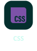
  
  
  
  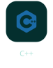
  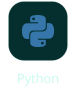
  

<b>Frontend</b>

  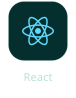
  
  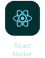
  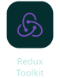
  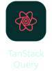
  
  
  
  

<b>Backend &amp; APIs</b>

  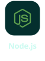
  
  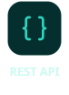
  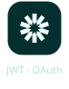
  
  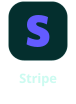

<b>Databases &amp; ORM</b>

  
  
  
  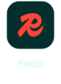
  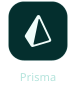
  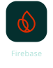

<b>DevOps &amp; Cloud</b>

  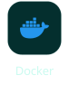
  
  
  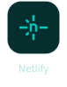

<b>Tools &amp; Workflow</b>

  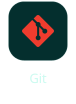
  
  
  
  
  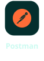

## :chart_with_upwards_trend: Current Stats

<table align="center">
  <tr>
    <td align="center" colspan="2">
      
    </td>
  </tr>
  <tr>
    <td align="center">
      
    </td>
    <td align="center">
      
    </td>
  </tr>
</table>

## :eyes: Current Overview

### 🌱 I'm exploring - Prisma ORM, NEST js
