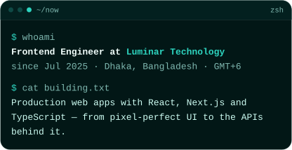

## :mailbox: Let's Connect

  
  
  

## :computer: Tech Stack

<h3 align="center">Languages</h3>

  
  
  
  
  
  
  
  

<h3 align="center">Frontend</h3>

  
  
  
  
  
  
  
  
  

<h3 align="center">Backend &amp; APIs</h3>

  
  
  
  
  
  

<h3 align="center">Databases &amp; ORM</h3>

  
  
  
  
  
  

<h3 align="center">DevOps &amp; Cloud</h3>

  
  
  
  

<h3 align="center">Tools &amp; Workflow</h3>

  
  
  
  
  
  

## :bar_chart: GitHub Stats

<table align="center">
  <tr>
    <td align="center" colspan="2">
      
    </td>
  </tr>
  <tr>
    <td align="center">
      
    </td>
    <td align="center">
      
    </td>
  </tr>
</table>

## :zap: Right Now

  
  

