## :mailbox: Reach Me Out

  
  
  

## :computer: Technologies that I learned

 

 

## :chart_with_upwards_trend: Current Stats

<table align="center">
  <tr>
    <td align="center" colspan="2">
      
    </td>
  </tr>
  <tr>
    <td align="center">
      
    </td>
    <td align="center">
      
    </td>
  </tr>
</table>

## :eyes: Current Overview

### 🌱 I'm exploring - Prisma ORM, NEST js
